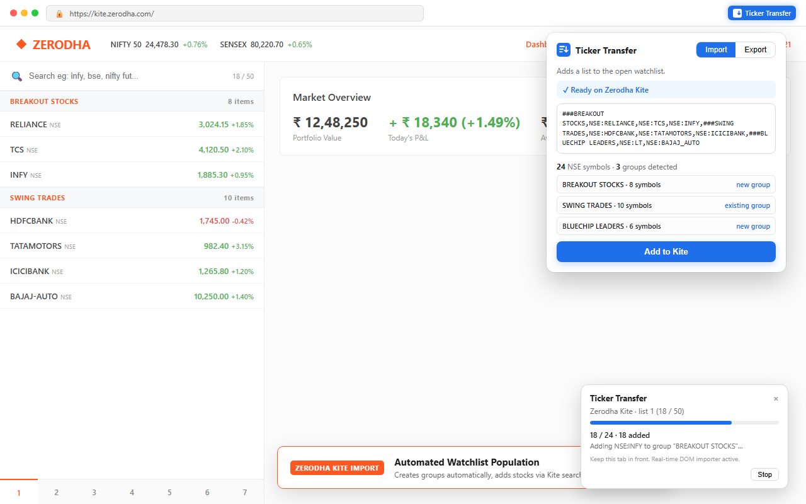
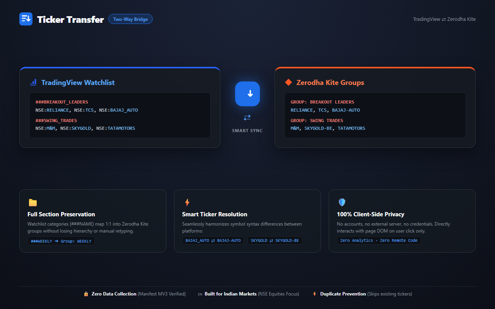

# Ticker Transfer

> **Seamlessly move stock watchlists between TradingView and Zerodha Kite with sections and groups intact.**

[](LICENSE)
[](manifest.json)
[](tests/)
[](https://addons.mozilla.org/firefox/addon/ticker-transfer/)

A watchlist takes time to build and is typically locked to the platform where it was created. Manually copying 100+ NSE symbols with multiple sections across platforms requires hours of tedious retyping and rebuilding groups.

**Ticker Transfer** automates the entire process. It reads the watchlist you already have open in your browser tab, preserves section structures (e.g. `###WEEKLY`, `###BREAKOUT`), and inputs symbols directly into the destination platform via native page controls—no API keys, no server communication, and zero data tracking.

---

## Visuals & Screenshots

| 1. Export from TradingView | 2. Import into Zerodha Kite |
| :---: | :---: |
|  |  |
| *One-click export preserving all `###SECTION` headers* | *Auto-creates groups & adds stocks with live progress* |

<p align="center">
  
  <br>
  <em>Intelligent symbol resolution & two-way synchronization engine</em>
</p>

---

## Key Features

- **Full Section & Group Preservation:**
  - TradingView sections (e.g. `###BREAKOUT`, `###SWING`, `###MONTHLY`) are converted directly into Zerodha Kite groups, and vice versa.
  - Automatically creates new groups on Zerodha Kite if they do not exist yet.
  - Adds stocks into their corresponding group without losing structure.

- **Two-Way Synchronization:**
  - **TradingView ➔ Zerodha Kite:** Read an open TradingView chart watchlist, copy or download the text, and populate your Kite marketwatch.
  - **Zerodha Kite ➔ TradingView:** Read your active Kite watchlist and groups, export as TradingView-compatible text, and import directly into TradingView.

- **Smart Ticker Resolution:**
  - Automatically harmonizes syntax differences across platforms:
    - `BAJAJ_AUTO` (TradingView) ⟷ `BAJAJ-AUTO` (Kite)
    - `M&M` (TradingView) ⟷ `M&M` (Kite)
    - `SKYGOLD` ⟷ `SKYGOLD-BE` / `SKYGOLD-BZ` (Handles series suffixes automatically)
  - Duplicate prevention: checks existing watchlist rows and never adds the same stock twice.
  - List limit guard: respects Zerodha Kite's watchlist capacity (e.g. 50/100 stocks) and reports skipped items cleanly when full.

- **100% Client-Side & Private:**
  - **No external server, analytics, tracking, or telemetry.**
  - **No account credentials or broker tokens required.**
  - Makes zero network requests (`fetch`, `XMLHttpRequest`, `WebSocket` are completely absent).
  - Operates solely within the active tab via native DOM interactions when you click the extension icon.
  - Declared `data_collection_permissions.required: ["none"]`.

---

## Watchlist Format

Ticker Transfer uses TradingView's native plain-text watchlist format. Each section begins with `###SECTION_NAME`, followed by comma-separated NSE tickers:

```text
###BREAKOUT_LEADERS,NSE:RELIANCE,NSE:TCS,NSE:INFY,###SWING_TRADES,NSE:HDFCBANK,NSE:TATAMOTORS,NSE:ICICIBANK,###BLUECHIP,NSE:LT,NSE:BAJAJ_AUTO
```

Because it uses standard plain text:
- You can save your watchlists as `.txt` files.
- You can edit symbols in any text editor before importing.
- You can copy-paste lists from notes, Telegram groups, or Excel sheets.

---

## How It Works

### 1. Exporting from TradingView
1. Open any chart on [tradingview.com](https://www.tradingview.com/chart/) and ensure the **Watchlist** panel on the right is open.
2. Click the **Ticker Transfer** toolbar icon.
3. The popup automatically scans the visible and virtualized watchlist rows, extracting symbols and sections.
4. Click **Copy List** or **Download .txt**.

### 2. Importing into Zerodha Kite
1. Navigate to [kite.zerodha.com](https://kite.zerodha.com/) and open your desired watchlist tab (e.g., list 1 to 7).
2. Click the extension toolbar icon and switch to the **Import** tab.
3. Paste your watchlist text (or click **Use the last export**).
4. Review the detected groups and stock counts, then click **Add to Kite**.
5. A floating progress panel appears at the lower-right corner of Kite, showing real-time addition, current group selection, and a **Stop** button.

### 3. Importing into TradingView
1. Open [tradingview.com/chart/](https://www.tradingview.com/chart/) with the Watchlist panel active.
2. Open the extension popup, go to the **Import** tab, and click **Add to TradingView**.
3. The extension opens TradingView's symbol search dialog, inputs the batch list, and triggers a single native Enter event, creating sections and stocks in one step.

---

## Development & Testing

### Prerequisites
- [Node.js](https://nodejs.org/) (v18+)
- Firefox Browser

### Getting Started

1. **Clone the repository:**
   ```bash
   git clone https://github.com/dineshsny4/ticker_transfer.git
   cd ticker_transfer
   ```

2. **Run tests:**
   ```bash
   npm test
   ```
   Runs the test suite across symbol normalization, export formatting, and parser logic:
   - `tests/listformat.test.js`
   - `tests/normalize.test.js`
   - `tests/tvexport.test.js`

3. **Start in Firefox (Development Mode):**
   ```bash
   npm start
   ```
   Launches Firefox with the extension loaded and opens TradingView automatically.

4. **Lint the extension:**
   ```bash
   npm run lint
   ```

5. **Build the production package:**
   ```bash
   npm run build
   ```
   Outputs the zipped add-on ready for AMO upload in `web-ext-artifacts/ticker_transfer-0.1.1.zip`.

---

## Requirements

- **Browser:** Mozilla Firefox 142.0+ (Manifest V3)
- **Permissions:**
  - `activeTab`: To inspect and interact with the active page upon user click.
  - `scripting`: To inject the importer/reader into the active tab.
  - `storage`: To persist your last exported list and popup draft locally on your machine.

---

## License

This project is licensed under the [MIT License](LICENSE) - see the [LICENSE](LICENSE) file for details.
