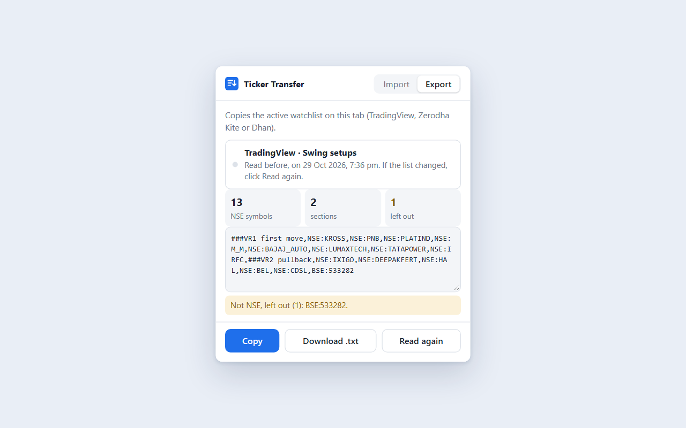
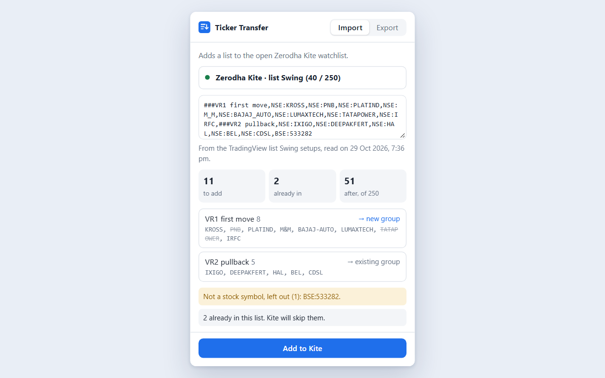
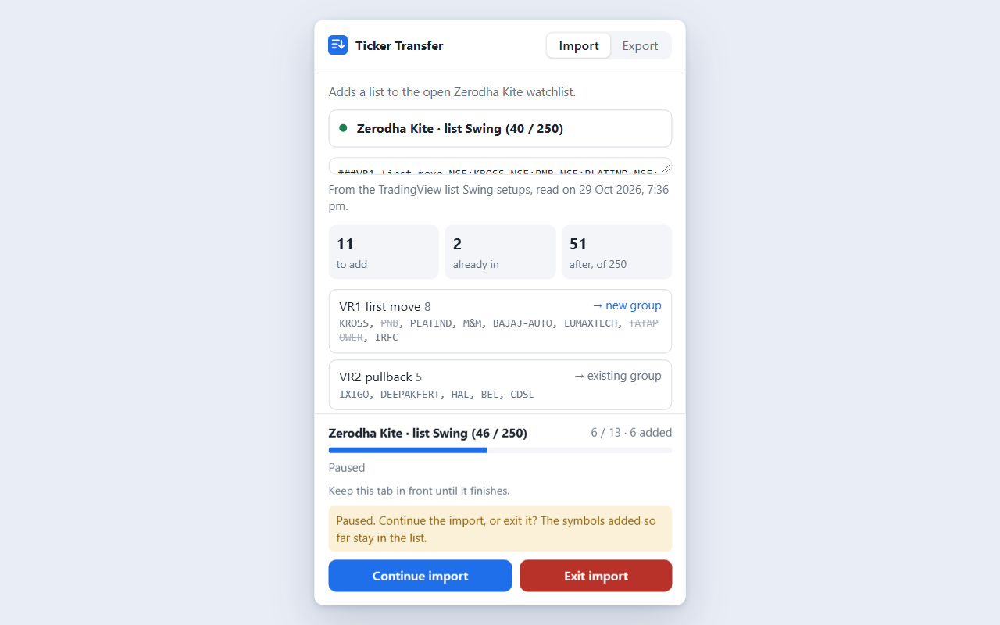
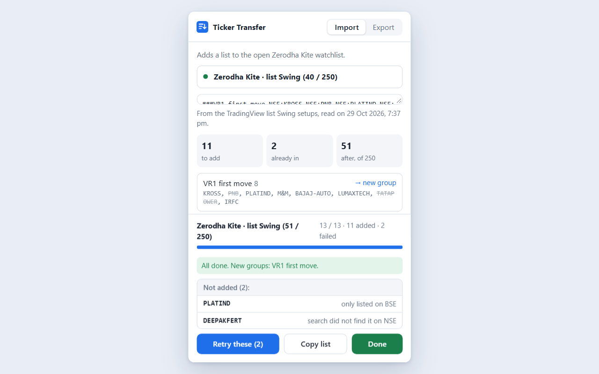
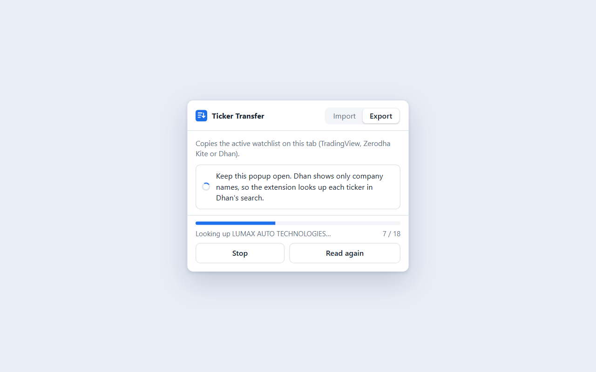
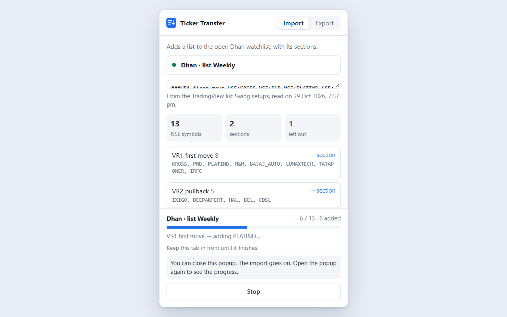
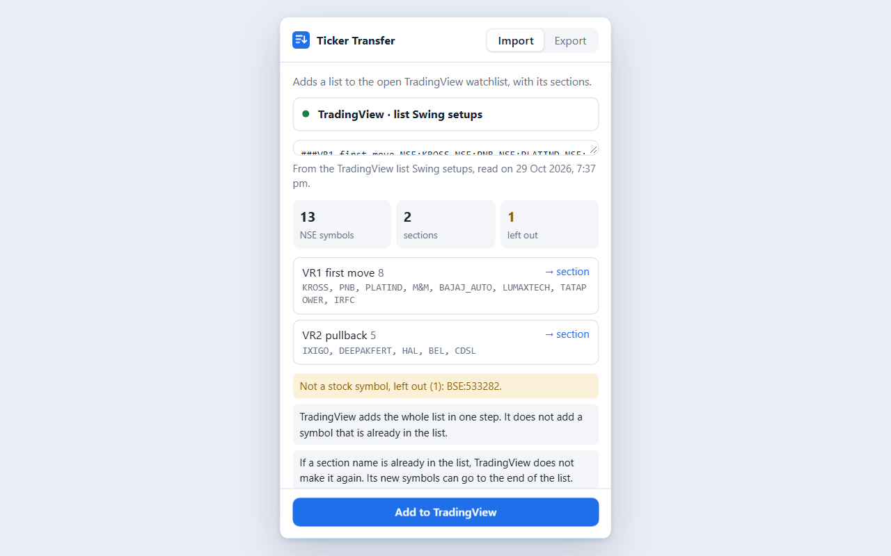

# Ticker Transfer

> **Move a stock watchlist between TradingView, Zerodha Kite and Dhan, with its sections and groups.**

[](LICENSE)
[](manifest.json)
[](tests/)
[](https://addons.mozilla.org/firefox/addon/ticker-transfer/)

A watchlist takes time to build, and it stays on the site where you built it. To move 100 or more NSE symbols in many sections by hand, you must type each symbol again and make each group again.

**Ticker Transfer** does this work for you. It reads the watchlist that is open in your browser tab and keeps its sections (for example `###WEEKLY` or `###BREAKOUT`). Then it adds the symbols on the other site with that site's own buttons and search box. It uses no API keys, no server and no tracking.

## Supported websites

| Site | Export | Import | How the import adds the list |
| :--- | :---: | :---: | :--- |
| [TradingView](https://www.tradingview.com/chart/) | ✓ | ✓ | The whole list in one step, through the "Add symbol" box |
| [Zerodha Kite](https://kite.zerodha.com/) | ✓ | ✓ | One stock at a time, through Kite's search box, into each group |
| [Dhan](https://tv.dhan.co/) | ✓ | ✓ | Finds each symbol in Dhan's search, then adds the whole list in one step |

You can move a list in all directions, for example TradingView to Kite, Kite to Dhan or Dhan to TradingView.

---

## Screenshots

| 1. Export from TradingView | 2. Import preview on Zerodha Kite |
| :---: | :---: |
|  |  |
| *Copy the list with its `###SECTION` headers* | *See the groups and the symbols that are already in the list* |

| 3. Stop pauses the import | 4. The result, with Retry |
| :---: | :---: |
|  |  |
| *Continue the import or exit it* | *See what did not go in, retry it or copy it* |

| 5. Export from Dhan | 6. Import into Dhan |
| :---: | :---: |
|  |  |
| *The extension finds each ticker in Dhan's search* | *Live progress in the popup* |

<p align="center">
  
  <br>
  <em>7. Import into TradingView: the whole list in one step</em>
</p>

---

## Key features

- **Sections and groups stay the same**
  - TradingView sections, Kite groups and Dhan sections all become `###NAME` lines in the export.
  - The import puts each stock into its own section or group. On Kite, it makes a group if the group does not exist.

- **Preview before you import**
  - The Import tab shows the target list and how many symbols it has.
  - It shows each section, and if it is a new group or an existing group.
  - It strikes out the symbols that are already in the list. The import skips them.
  - It names each symbol that it leaves out, with the reason.

- **Progress in the popup, on all sites**
  - A progress bar shows the current symbol and the count.
  - **Stop** pauses the import. Then you can continue it or exit it. The stocks that it added stay in the list.
  - You can close the popup during a Kite or Dhan import. Open it again to see the progress.
  - At the end, the popup lists each stock that it could not add, with the reason.
  - **Retry** tries those stocks again in their own sections. **Copy list** copies them. **Done** (green) takes you back to the Import tab.

- **Symbol names match across sites**
  - `BAJAJ_AUTO` (TradingView) ⟷ `BAJAJ-AUTO` (Kite)
  - `M&M` (TradingView) ⟷ `M&M` (Kite)
  - `SKYGOLD` ⟷ `SKYGOLD-BE` / `SKYGOLD-BZ` (Kite series suffixes)
  - On Dhan, the extension picks the NSE listing (`SYMBOL-EQ`).
  - The extension never adds a stock two times to one list. On Kite, it stops at the list limit that the page shows.

- **NSE only**
  - The extension moves NSE symbols only, because all three sites share this listing.
  - It leaves out BSE-only stocks and other exchanges, and the popup names each one.

- **Private and safe**
  - No server, no analytics, no tracking and no telemetry.
  - No account details or broker tokens. The extension uses the page where you are already signed in.
  - No network requests of its own (no `fetch`, `XMLHttpRequest` or `WebSocket`).
  - It runs only after you click the toolbar icon, and only on the open tab.
  - It clicks only watchlist controls. It never clicks Buy, Sell, or any order, holdings or funds control.
  - The manifest declares `data_collection_permissions.required: ["none"]`.

---

## Watchlist format

Ticker Transfer uses TradingView's own plain-text watchlist format. Each section starts with `###SECTION_NAME`, followed by comma-separated NSE tickers:

```text
###BREAKOUT_LEADERS,NSE:RELIANCE,NSE:TCS,NSE:INFY,###SWING_TRADES,NSE:HDFCBANK,NSE:TATAMOTORS,NSE:ICICIBANK,###BLUECHIP,NSE:LT,NSE:BAJAJ_AUTO
```

Because it is plain text:
- You can save a watchlist as a `.txt` file (Export has a **Download .txt** button).
- You can edit the symbols in a text editor before you import them.
- You can paste a list from your notes, a chat or a spreadsheet.

---

## How to use it

Show the watchlist on the page before you click the icon. The extension does not open the watchlist panel for you. If the panel is not visible, the popup tells you what to do.

### Export
1. Open the site that has your list:
   - **TradingView:** open a chart and show the **Watchlist** panel on the right.
   - **Zerodha Kite:** open the watchlist on the left side of the page. If the window is narrow, make it wider.
   - **Dhan:** open [tv.dhan.co](https://tv.dhan.co/), wait for the chart, and show the **Watchlist** panel on the right.
2. Click the **Ticker Transfer** toolbar icon. The **Export** tab reads the open watchlist.
3. Click **Copy** or **Download .txt**.

On Dhan, a watchlist row shows only the company name. The extension finds each ticker in Dhan's search, about one second for each stock. Keep the popup open until it finishes, or click **Stop**.

### Import
1. Open the target site and the target watchlist. Use a spare list for your first test.
2. Click the toolbar icon and open the **Import** tab.
3. Click **Use the last export**, or paste a list.
4. Look at the preview: the groups, the symbols that are already in the list, and the symbols that are left out.
5. Click **Add to TradingView**, **Add to Kite** or **Add to Dhan**.
6. Watch the progress in the popup. Click **Stop** to pause, then **Continue import** or **Exit import**.
7. At the end, use **Retry** or **Copy list** for the stocks that did not go in. Click **Done**.

Keep the site tab in front until the import finishes.

---

## Development and testing

### Prerequisites
- [Node.js](https://nodejs.org/) (v18 or later)
- Firefox

### Getting started

1. **Clone the repository:**
   ```bash
   git clone https://github.com/dineshsny4/ticker_transfer.git
   cd ticker_transfer
   ```

2. **Run the tests:**
   ```bash
   npm test
   ```
   The unit tests cover symbol names, the list format and the TradingView export:
   - `tests/listformat.test.js`
   - `tests/normalize.test.js`
   - `tests/tvexport.test.js`

3. **Start Firefox with the extension:**
   ```bash
   npm start
   ```
   Firefox opens with the extension loaded, on a TradingView chart.

4. **Lint the extension:**
   ```bash
   npm run lint
   ```

5. **Build the package:**
   ```bash
   npm run build
   ```
   The zip for AMO goes into `web-ext-artifacts/` (for example `ticker_transfer-0.2.1.zip`).

---

## Requirements

- **Browser:** Mozilla Firefox 142.0 or later (Manifest V3)
- **Accounts:** a TradingView account, a Zerodha account for Kite, or a Dhan account for Dhan.
- **Permissions:**
  - `activeTab`: to read and act on the open tab after you click the icon.
  - `scripting`: to load the reader and importer into that tab.
  - `storage`: to keep your last export, the Import draft and the last popup tab on your computer.

---

## License

This project uses the [MIT License](LICENSE). See the [LICENSE](LICENSE) file for details.
